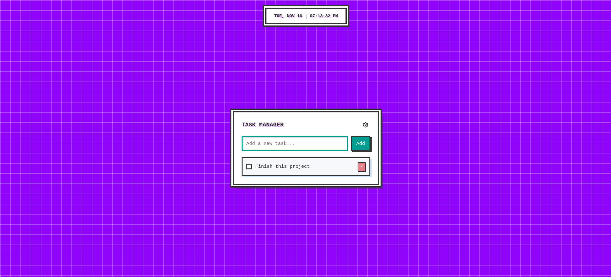

# PixelTasks
Welcome to PixelTasks, a task manager built pixel-themed

### Try it
To try the demo website out, click they try it button below!
### <kbd>[Try It!!!](https://example.com)</kbd>
### Features
- Settings button that changes style
- Pixel theme
- Helps manage your tasks
### How it works
The task manager in run client-side meaning it will save the tasks locally to your computer's localStorage. The task you type will be saved in localStorage and can then be marked complete and/or deleted after you complete them. <b>Want to know more, see the site for yourself!</b>

